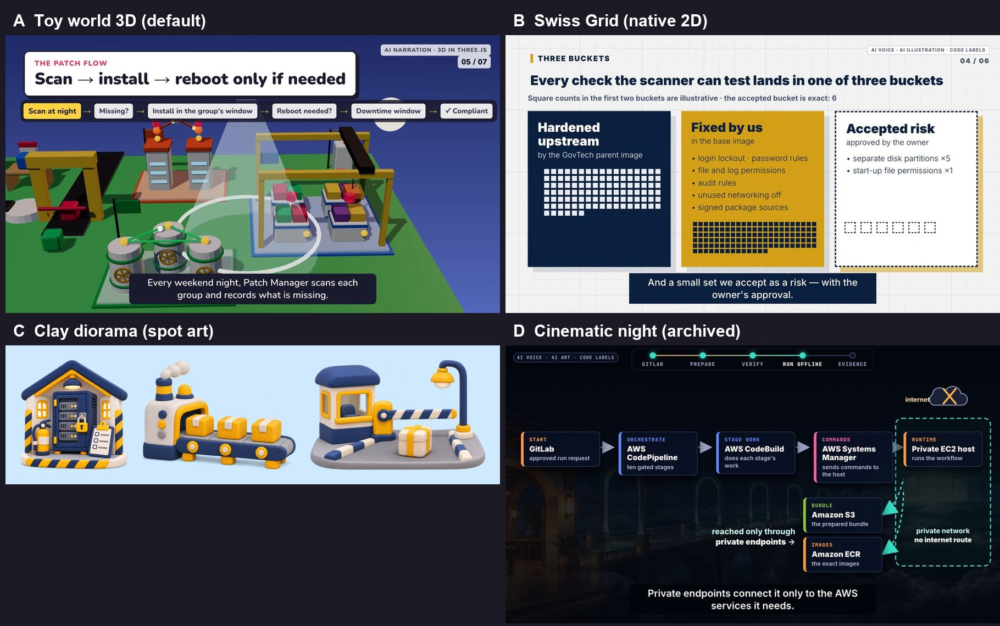

# Video Demo — technical explainer films

> **New films are made in the private factory [`amitkarpe/video-factory`](https://github.com/amitkarpe/video-factory)** (start protocol, toolkit, house styles). This public repository is the **showcase and archive**: the 20 films made here between 7 and 10 Nov 2026, plus factory films that Amit approves for public release (as GitHub Releases `film-<source-repo>-<film>`).

Short, narrated, captioned films that explain Amit's engineering work (AWS Factory, AWSOps, Nextflow offline, the agentic pentest PoC) to engineers and managers. Each film is built as code: HyperFrames compositions (HTML, GSAP and Three.js), an OpenAI voice, a synthesized score, and a checked evidence map.



## Start here
| You want to… | Read |
|---|---|
| **Make a new film** | The private factory [`amitkarpe/video-factory`](https://github.com/amitkarpe/video-factory): its `AGENTS.md` start protocol |
| Revise an archived film here | [Intake card](docs/VIDEO_INTAKE.md) → [Style catalog](docs/STYLE_CATALOG.md) → [Agent Video Playbook](docs/AGENT_VIDEO_PLAYBOOK.md) |
| Watch or reuse a finished film | [`films/`](films/README.md): one folder per source repository and film; videos on GitHub Releases |
| Reuse a look | [`styles/`](styles/): `toy-world-3d` (default), `swiss-grid`, `clay-diorama`, `cinematic-night` (archived) |
| Use the shared scripts | [`toolkit/`](toolkit/README.md) |
| Agent rules and authority | [`AGENTS.md`](AGENTS.md) (router), [`SPEC.md`](SPEC.md), [`CONTEXT.md`](CONTEXT.md) |

**House rule: reuse first.** Use a house look and the toolkit. A new theme is made only when Amit asks for one by name.

## Layout
```
films/<source-repo>/<film>/   one self-contained film (script, src, build.py, claims, QA record, keyframes)
styles/<look>/                reusable look: kit/, preview.jpg, README
toolkit/                      shared build, voice, image, ledger and QA scripts (one copy)
docs/                         playbook, intake card, style catalog, research and reviews
labs/                         side experiments (voice lab)
intent/                       accepted project intent
```

## Setup (once)
```bash
npm ci                                   # pinned HyperFrames 0.9.20 + GSAP 3.15.0
python3 -m venv .venv && .venv/bin/pip install numpy==2.5.4 soundfile==0.14.0 pillow==13.0.0 websockets==15.0.1
```
You also need Node 22+ and FFmpeg. An OpenAI key is needed only for new voice, images or paid QA, and only through an ignored `.env` or the environment, never committed. Start a film with `python3 toolkit/new_film.py --repo <source-repo> --slug <film> --style toy-world-3d`.

## Template model
The shared agent contracts are kept and routed by `AGENTS.md`: `AI_NATIVE_SDLC.md`, `intent/README.md`, `CHATGPT.md`, `ENV.md`, `INIT.md`, `ROADMAP.md`. Reusable cross-project policy lives in `amitkarpe/agents` and is linked, not copied.
