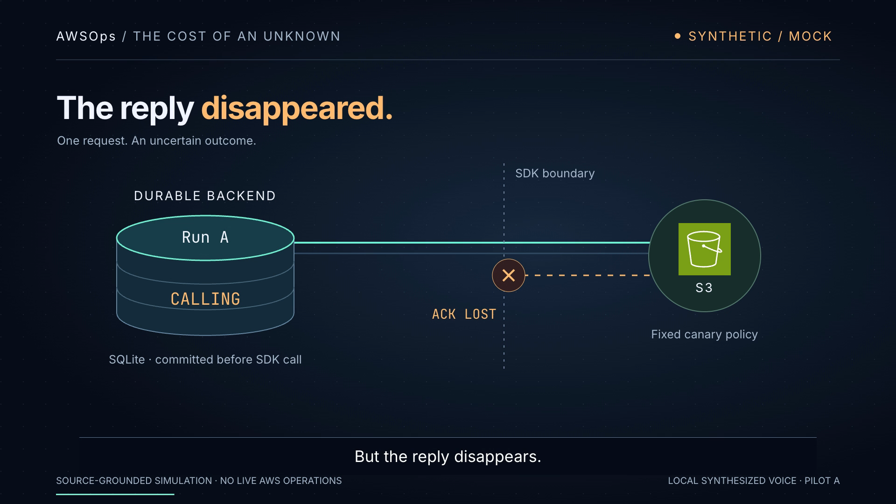
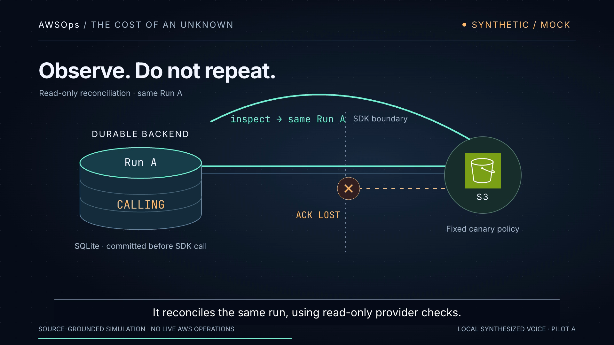
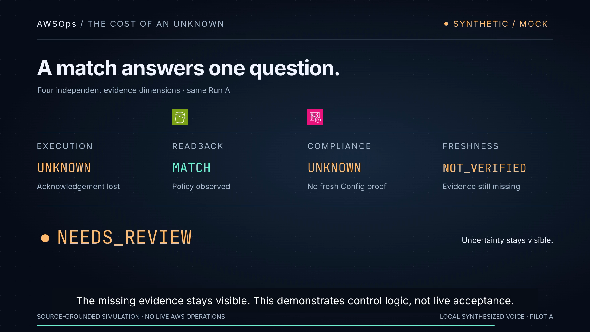

# Pilot A — The reply disappeared

One 53-second, source-grounded AWSOps simulation for experienced CloudOps / DevSecOps engineers. Owning [issue #15](https://github.com/amitkarpe/video-demo/issues/15). **Human creative and listening acceptance: PENDING.**

[Download / play the full MP4](pilot.mp4) · [17-second mechanism preview](preview.mp4) · [Captions](captions.srt) · [Transcript](transcript.txt) · [Verification](verification.json) · [Sources and licenses](SOURCES.md)

GitHub may show a download button rather than an inline player. Download `pilot.mp4` and open it in QuickTime, VLC or a browser. The MP4 includes burned-in English captions and synthesized narration; the SRT is also supplied separately.

## Accepted scope and goal

Amit accepted the restated intent in the owning Codex conversation on 8 November 2026: “Accepted. Go ahead and complete the pilot and draft PR for issue #15.” The accepted intent is issue #15's independent short pilot, local setup/build/validation, and exactly one new draft PR. No merge, deployment, AWS operation, paid API call or full-film expansion.

**GOAL:** Make one consequential mechanism understandable in one viewing: uncertainty survives a lost acknowledgement; policy match is not fresh compliance proof. **REAL BLOCKER:** none for local delivery; human listening/taste remain unverified acceptance categories. **MINIMUM USEFUL ACTION:** source-grounded animated short and playable review artifact. **STOP CONDITION:** one pilot and one draft PR, followed by owner review.

The work starts from `995e8287847b77f81707e485f9767700bc98c162`, on `feat/pilot-codex-unknown-ack`. PR base: `feat/10-engineering-deep-dive`. All pilot additions live in this folder. No competitor source, narration or visual treatment was read or reused. The old AWSOps film was a factual and failed-aesthetic reference only.

## Two treatments considered

1. **Selected — signal-path cutaway.** Borrow the progressive mechanism reveal from HyperFrames' [explainer guidance](https://hyperframes.heygen.com/guides/faceless-explainer). A luminous request crosses a fixed SDK boundary; its return breaks; a durable cylinder retains Run A. A read-only arc returns to the same identity. Restrained teal signals observation; amber signals uncertainty. Large type and empty space keep the technical consequence readable.
2. **Alternative — paper audit chronology.** Use the record separation in the [Defence Factory contract](https://github.com/amitkarpe/awsops/blob/15c12fb5362dd05fc4d8aaf10ebd31d3ce2935d9/contracts/defence-factory/README.md) as an editorial reference: dated evidence marks along a horizontal timeline, with a missing acknowledgement leaving a visible gap. This could teach ordering well, but offers less spatial continuity for a short pilot. No second video was built.

These are references for teaching and composition, not copied footage or branded UI. The actual three-frame design board was captured before the full render. A narrated 17-second mechanism slice was rendered and visually inspected before the full export.

## Shot list

| Time | Focus / change / consequence |
| --- | --- |
| 0–6.7 s | Request traces from the committed ledger toward S3; one controlled operation. |
| 6.7–12.9 s | Return packet disappears at the SDK boundary; a question holds. |
| 12.9–23.2 s | Ledger enlarges around CALLING; a crossed retry arc shows why another write is withheld. |
| 23.2–28.1 s | Read-only observation traces back to the same Run A; no new write or run appears. |
| 28.1–42.5 s | The diagram gives way to four independent evidence fields; MATCH never turns the other fields green. |
| 42.5–53 s | NEEDS_REVIEW appears; a calm final hold keeps the missing evidence visible. |





## Rebuild

Requirements: Node 22+, npm, Python 3, FFmpeg / ffprobe, and compatible Chrome. From `benchmarks/hyperframes`:

```sh
npm ci
cp node_modules/gsap/dist/gsap.min.js pilots/codex-unknown-ack/assets/gsap.min.js
python3 pilots/codex-unknown-ack/build.py
npx hyperframes lint pilots/codex-unknown-ack
sh pilots/codex-unknown-ack/render.sh
ffmpeg -v error -i pilots/codex-unknown-ack/pilot.mp4 -f null -
```

`scene.html.template` is the editable vector/motion source. `build.py` combines it with measured audio durations and generates `index.html`, `timing.json`, the SRT and transcript. The committed WAVs allow visual edits without TTS dependencies or model downloads. `render.sh` renders once, then normalizes narration to a target −16 LUFS with FFmpeg while copying the encoded video unchanged. The delivered master measures -16.12 LUFS and -1.49 dBTP. The preview is the final master’s 12–29 second interval. After editing spoken text, regenerate speech explicitly with `--voice`; otherwise existing audio stays cached. Font rendering may vary across hosts; bit-identical encoding is not promised. The scene uses Arial and Menlo with system fallbacks.

To regenerate the **new** narration locally:

```sh
uv venv --python 3.12 pilots/codex-unknown-ack/.build/venv
uv pip install --python pilots/codex-unknown-ack/.build/venv/bin/python -r pilots/codex-unknown-ack/requirements-voice.lock
curl -fL https://github.com/thewh1teagle/kokoro-onnx/releases/download/model-files-v1.1/kokoro-v1.0.onnx -o pilots/codex-unknown-ack/.build/kokoro-v1.0.onnx
curl -fL https://github.com/thewh1teagle/kokoro-onnx/releases/download/model-files-v1.1/voices-v1.0.bin -o pilots/codex-unknown-ack/.build/voices-v1.0.bin
pilots/codex-unknown-ack/.build/venv/bin/python pilots/codex-unknown-ack/build.py --voice
```

The generator verifies both model hashes before loading them. Model weights, environments and render logs stay ignored under `.build/`.

## Review limits and production record

- Toolchain: HyperFrames 0.9.20 and GSAP 3.15.0 from the unchanged baseline npm lock. Voice: Kokoro ONNX 0.6.1, `am_michael`, speed 0.98, CPU inference. Exact Python dependency lock included.
- Agent: Codex, active runtime identity GPT-6; exact backend variant is not independently exposed. One writer, no delegated worker. One treatment; one voice generation; first slice exposed three lint defects, corrected slice passed; one full render was interrupted by the owner's new instruction and restarted after the worktree move. One final audio level adjustment preserved the encoded video stream and timing. No duration-driven narration regeneration.
- Source verification: pinned implementation inspected; this is an authored illustration, not a live execution or an automatically generated trace. “Run A” is an editorial alias.
- Voice text expands `S3` to “S three” and `AWSOps` to “A W S Ops.” State names use spoken forms. Grammar and text checked; independent audible pronunciation/prosody review of AWSOps, S3, CALLING, Config and NEEDS_REVIEW: **NOT_VERIFIED**. SQLite is visual only. No STS identity is depicted or spoken.
- Captions follow complete measured voice clips with reading pauses. This is sentence-level timing, not independently verified word alignment. Final encoded 720p samples are inspected separately.
- Desktop playback: final mastered MP4 played from 0 to 53 seconds in QuickTime, with final NEEDS_REVIEW visible. The agent observed controls and picture progression; this does not certify audible pronunciation.
- Computer preflight: desktop inventory and QuickTime AX controls accessible. GitHub repo identity/permission readback and push dry run passed. Key presence check returned `set`; no key was printed or used. The local production needs no API credential.
- The owner requested `/Users/apple/git/worktree/video-demo-15-unknown-ack`; native `git worktree move` preserved this lane. The app rejected reattachment because the moved checkout is not managed. Commands use the explicit new path.
- Incremental paid API/software/cloud spend: **USD 0**. No AWS operations, no cloud rendering, no third-party video hosting. Codex subscription usage and existing equipment are not priced here.
- Owner decides comprehension, beauty, motion, voice and subtitle clarity, each 1–5. This delivery does not certify those subjective scores or live AWSOps acceptance.
