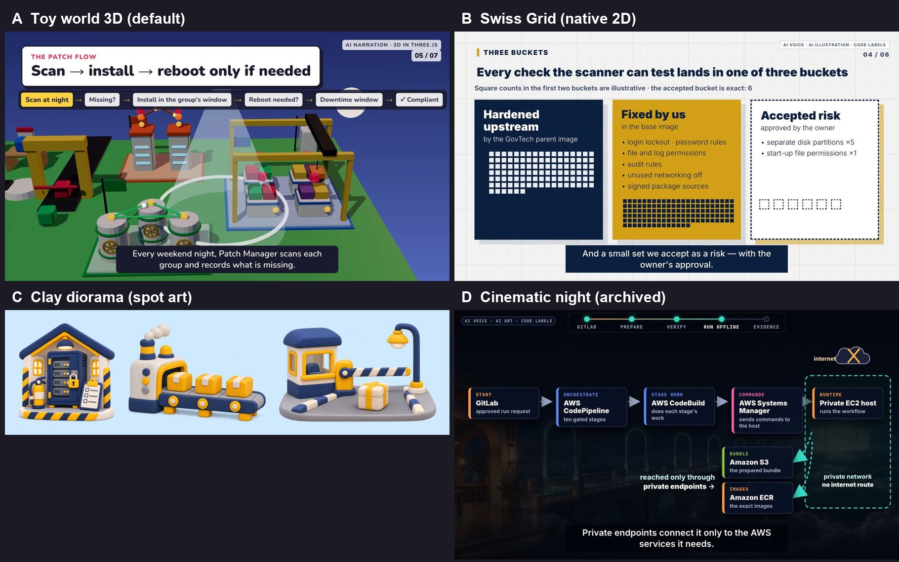

# Style Catalog — our house looks

**Rule: reuse a house look.** Do not invent a new theme unless the owner explicitly asks for one (see [the intake card](VIDEO_INTAKE.md), Q5).

| | Name (say this) | What it is | Use when | Start a film |
|---|---|---|---|---|
| **A** | `toy-world-3d` · **default** | Bold toy-block 3D island in Three.js: primary colours, hard sun, each group its own moving building, a night/day sky, a continuous camera path | Most explainers, especially flows across several systems or families | `python3 toolkit/new_film.py --repo <repo> --slug <slug> --style toy-world-3d` |
| **B** | `swiss-grid` | Native HyperFrames Swiss Grid: navy and gold on grid paper, hard offset shadows, code-drawn diagrams | Compliance, numbers, checklists; a 2D, sober look | `python3 toolkit/new_film.py ... --style swiss-grid` |
| **C** | `clay-diorama` | AI clay miniature **spot illustrations** (transparent PNGs) | Plain-language metaphors on top of A or B | Prompts in `styles/clay-diorama/prompts.example.json` |
| **D** | `cinematic-night` · archived | Dark AI concept-art plates, amber and teal light, code labels | Only when the owner names it | Copy from `films/nextflow-offline/offline-validation/` |

Reference films (watch them on their GitHub Release):
- **A:** [`films/aws-factory/ssm-patch`](../films/aws-factory/ssm-patch/README.md), accepted.
- **B and C:** [`films/aws-factory/cis-hardening`](../films/aws-factory/cis-hardening/README.md).
- **D:** [`films/nextflow-offline/offline-validation`](../films/nextflow-offline/offline-validation/README.md) and [`films/agentic-pentest-poc/claude-film`](../films/agentic-pentest-poc/claude-film/README.md).

Native HyperFrames examples are still available as raw material (`npx hyperframes init <dir> --example <name>`): warm-grain, swiss-grid, vignelli, nyt-graph, decision-tree, kinetic-type, play-mode, product-promo. Explainer blocks: `npx hyperframes add flowchart | hw-pipeline | exploded-stack | data-chart`.

**Adding a look:** only after the owner accepts a film in it. Put a `kit/`, `README.md` and `preview.jpg` under `styles/<name>/`, then add a row here and a tile to `styles/catalog.jpg`.
