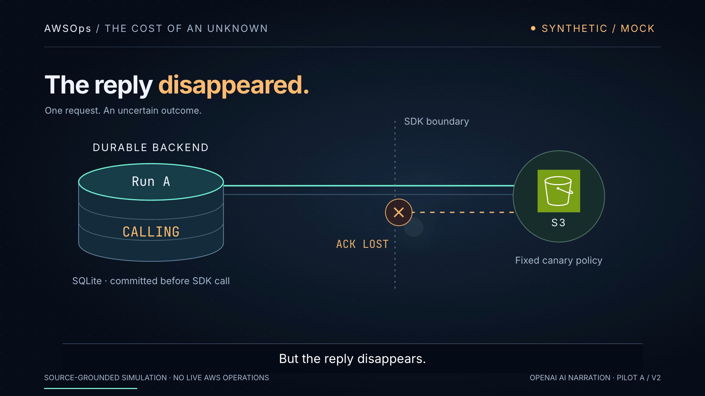
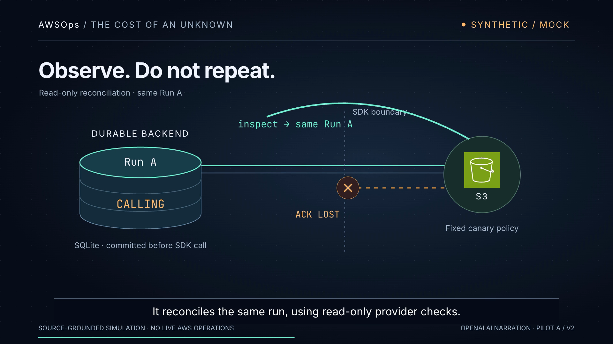
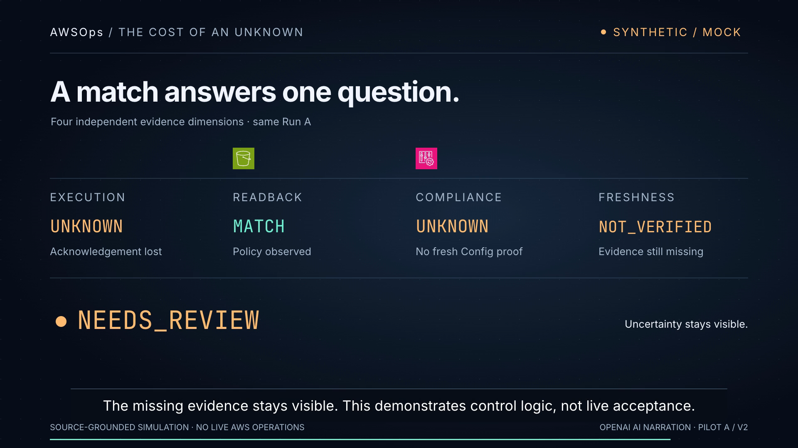

# Pilot A v2 — The reply disappeared

**Watch:** Release removed (10 Nov 2026, owner decision). It held `pilot.mp4` (sha256 `4659c2112dbe…`) · `preview.mp4` (sha256 `5087b2453b68…`). Paths such as `out/*.mp4` below are where a local build writes them.


One 45-second AWSOps technical short for experienced CloudOps / DevSecOps engineers. **Source-grounded simulation. Human listening and creative acceptance: PENDING.**

Full MP4 (release removed) · Mechanism preview (release removed) · [Captions](captions.srt) · [Transcript](transcript.txt) · [Verification](verification.json) · [Call-by-call OpenAI meter](openai-spend.json) · [Sources](SOURCES.md)

Download the MP4 and open it in QuickTime/VLC if GitHub does not show an inline player. English captions are burned in; the separate SRT supports other players.

## One approved improvement cycle

Owning [issue #15](https://github.com/amitkarpe/video-demo/issues/15), existing [draft PR #17](https://github.com/amitkarpe/video-demo/pull/17). The [Phase 1 report](https://github.com/amitkarpe/video-demo/issues/15#issuecomment-6719298666) preceded approval. Amit then wrote in the owning conversation: “Must Use up to USD 5 for an OpenAI text-to-speech voice for the narration only, with each call metered and stopped before the cap. go approved.” This approves Treatment A and supersedes the plan's local-voice / USD 0 choice. It does not approve other paid uses, AWS operations, deployment, merge or full-film expansion.

**GOAL:** Preserve the one-viewing technical lesson while improving continuity, text clarity and narration. **REAL BLOCKER:** agent lacks an audible input channel; Amit supplies listening/taste acceptance. **MINIMUM USEFUL ACTION:** one revised short on the existing branch/PR. **STOP CONDITION:** revised draft PR and final evidence comment on #15 for ChatGPT/owner review.

## What changed from v1

| v1 | v2 |
| --- | --- |
| Local Kokoro narration, 53 seconds | OpenAI TTS-1 HD / Onyx, 45 seconds at natural speed 1.0; no speed-up to meet runtime. Same spoken message. |
| Fixed system view | Controlled camera emphasis when the reply disappears and return to context for readback. |
| Readback arc could intersect the backend label | Repositioned path/label and delayed directional arrow after the path finishes drawing. |
| Direct map-to-evidence cut | The same S3 icon travels from the system map into READBACK. Titles fade sequentially to avoid collisions. |
| Other evidence fields dimmed for focus | Every essential field keeps full readable contrast; a moving underline directs attention. |

[v1 MP4, preserved at ccc0807](https://raw.githubusercontent.com/amitkarpe/video-demo/ccc0807153da93006b55ce48b934351978ad78ed/benchmarks/hyperframes/pilots/codex-unknown-ack/pilot.mp4). v1 SHA-256: `e6c431badb0c0bf409abf9319335a1e87d73458931ce9d69d19766c66b261960`. No competitor source or creative work was inspected or reused. No second pilot or duplicate PR.

## Creative treatment and shot list

**Selected: continuous technical cutaway.** Teal traces a request and provider observation; amber preserves uncertainty. A persistent run identity connects the SDK boundary, committed ledger and independent evidence fields. Reference: [HyperFrames teaching-led explainer guidance](https://hyperframes.heygen.com/guides/faceless-explainer).

**Alternative considered: forensic audit timeline.** Commit → call → missing ACK → observation laid out chronologically. It clarifies ordering but gives less spatial continuity. Reference: the pinned [Defence Factory record separation](https://github.com/amitkarpe/awsops/blob/15c12fb5362dd05fc4d8aaf10ebd31d3ce2935d9/contracts/defence-factory/README.md). No alternative film was generated.

| Time | Focus / change / consequence |
| --- | --- |
| 0–5.7s | One approved fixed request crosses the SDK boundary. CALLING is already durable. |
| 5.7–11s | The return disappears; camera emphasis exposes uncertainty. |
| 11–19.9s | Ledger enlarges around the same Run A. A crossed retry path blocks blind repetition. |
| 19.9–23.8s | Read-only observation returns to the same identity. |
| 23.8–35.6s | S3 identity carries into readback MATCH. All four independent fields stay readable. |
| 35.6–45s | NEEDS_REVIEW holds. Missing evidence stays visible. |

The three actual designed frames and narrated mechanism slice were checked before final delivery. Encoded-frame checks prompted one transition correction. No narration was regenerated for that correction.





## OpenAI narration and hard spending boundary

12 successful narration-only calls, 614 input characters. **Metered billable amount: USD 0.01842 at the published USD 30 / million-character rate.** The USD 5 lane cap leaves USD 4.98158 unused. Charges covered by credits still count. This is character-metered list-price cost; invoice reconciliation is not independently available. Account-wide balance changes are not attributed to this pilot.

`openai-spend.json` records every input count/hash, pre-call reservation, request ID, returned audio hash, completion and cumulative amount. `generate_openai_voice.py` saves each reservation before sending one request. It refuses the next call if all reservations plus its known cost exceed USD 5. Any uncertain call retains its reservation and stops the whole chain without automatic retry. All successful audio is cached. No more calls are required.

The model is documented as available until 6 January 2027; it was chosen here for explicit per-character billing and a bounded one-off narration. Cached audio makes future film rebuilds independent of endpoint retirement. Streaming WAV length headers were finalized locally; the returned PCM samples were unchanged. No API call was repeated for that repair.

## Rebuild without API calls

Requirements: Node 22+, npm, Python 3, FFmpeg/ffprobe and compatible Chrome. From `benchmarks/hyperframes`:

```sh
npm ci
python3 pilots/codex-unknown-ack/check_voice_budget.py
sh pilots/codex-unknown-ack/render.sh
ffmpeg -v error -i pilots/codex-unknown-ack/pilot.mp4 -f null -
```

`scene.html.template` owns editable SVG/motion. `build.py` checks cached narration against the speech ledger and literal script, then generates HTML, timings, SRT and transcript. `render.sh` restores pinned GSAP, lints, renders and normalizes audio to a target −16 LUFS while copying the encoded video unchanged. Rebuilds do not load secrets or make speech calls. Font/codec differences across hosts can change output bytes.

Paid speech generation is separate and requires explicit opt-in. The completed ledger prevents resending these calls. Do not delete/reset it to regenerate: a new voice iteration needs a separate bounded decision. The script reads only the process's `OPENAI_API_KEY` and sends only public narration to `https://api.openai.com/v1/audio/speech`. It never prints the key, copies env files or retries an uncertain request. No SDK or new dependency installation was required. `requirements-voice.lock` is retained only as the v1 Kokoro environment record.

## Evidence and limits

- Actual source remains AWSOps `15c12fb5362dd05fc4d8aaf10ebd31d3ce2935d9`, read only. MATCH does not change unresolved execution UNKNOWN, compliance UNKNOWN or freshness NOT_VERIFIED. Read-only reconciliation means no provider mutation; it may persist evidence to SQLite. Run A is an editorial alias.
- Toolchain: unchanged locked HyperFrames 0.9.20 / GSAP 3.15.0; Node 26.12.1; FFmpeg 9.0.2; Python standard library for v2 build/speech/metering.
- Voice: OpenAI TTS-1 HD, Onyx, speed 1.0. Full-frame AI voice disclosure included. `S3` is spoken as “S three”; `AWSOps` as “A W S Ops.” State names use spoken forms. SQLite is visual only; no STS identity depicted.
- The agent can inspect actual encoded pictures, seek/play QuickTime, measure audio and check caption structure. It has no audible input channel. Pronunciation/prosody and human comprehension remain NOT_VERIFIED / PENDING. Fallback: Amit listens to the 45-second file once and reports specific defects. Caption timing is measured per sentence, not independently verified word alignment.
- Host-path repair: actual worktree remains `/Users/apple/git/worktree/video-demo-15-unknown-ack`. The old chat path is now a directory link to that same checkout. Default CLI commands resolve to the correct clean Git identity; no duplicate clone, app database/config edit or repo move.
- Production: one approved revision cycle, 12 TTS calls, one narrated slice, full export and one local transition correction. No extra paid call for visual iteration. Model/agent choice: existing Codex desktop writer, no new worker.
- Final QuickTime playback was observed starting and progressing, but end-of-file UI readback timed out after the owner interruption. Full-file FFmpeg decode passes; owner playback/listening is the final fallback.
- Final mechanical metrics and separate human acceptance status are in `verification.json`. No paid images/text/review APIs, AWS operations, cloud rendering, third-party video hosting, merge or full-film expansion.
