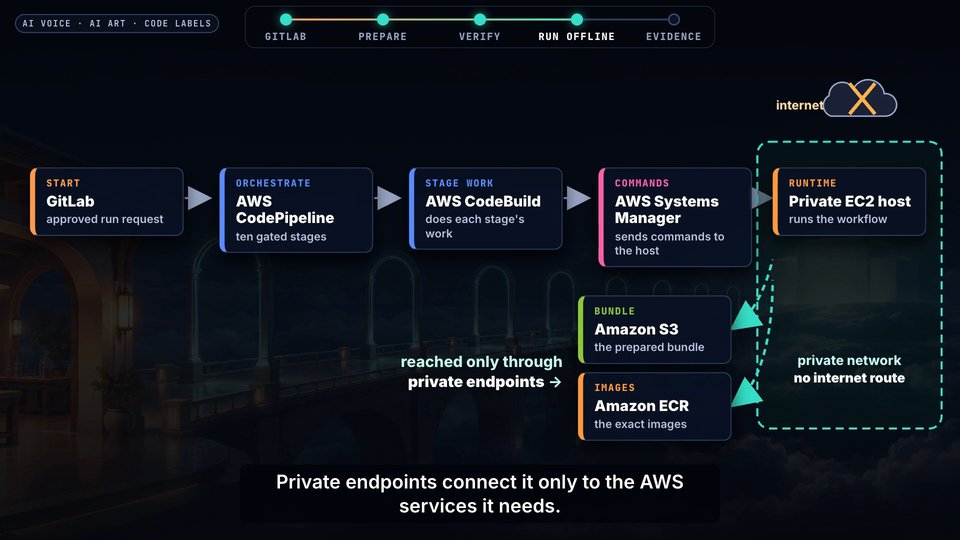
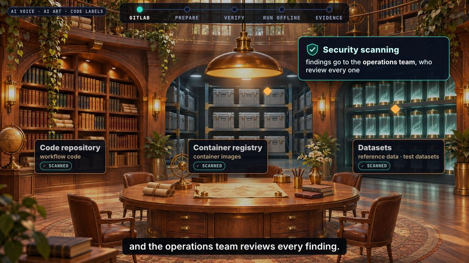

# cinematic-night (archived)

 

The look of the first Claude films:
- dark 2.5D AI concept-art plates (night castles, labs and gates)
- amber and teal light
- code-drawn labels and slow camera drifts

It looks impressive, but each film needed many generated plates and a long art-direction pass. The owner asked for variety and then for reuse, so this look is **archived: use it only when the owner names it**.

- **Reference films:** [`films/nextflow-offline/offline-validation`](../../films/nextflow-offline/offline-validation/README.md) and [`films/agentic-pentest-poc/claude-film`](../../films/agentic-pentest-poc/claude-film/README.md).
- **Prompt recipe:** `prompts.example.json`, from the Nextflow film. Its `edit_of` entries keep one object identical across scenes.
