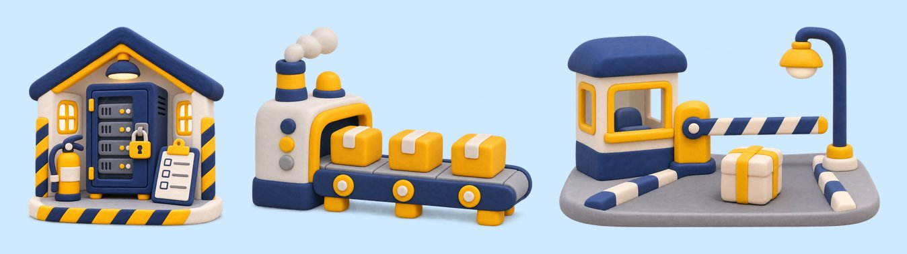

# clay-diorama (spot illustrations)

Bright miniature clay objects on a transparent background, made with OpenAI images (`gpt-image-2.6-sunburst`, `background: transparent`). Use them as **spot art** over `toy-world-3d` or `swiss-grid` for plain-language metaphors. They never carry facts or labels.

- **Prompt recipe:** `prompts.example.json`. Keep its shared `style` sentence, and change the palette words to match the host look. Every prompt says "no text, no letters, no logos".
- **Pipeline:** run `toolkit/gen_images.py` from the film folder. Originals are saved untouched under `media/original/images/`, then `toolkit/derive.py` crops them to their alpha.
- **Cost:** about USD 0.05 per image at "high".
