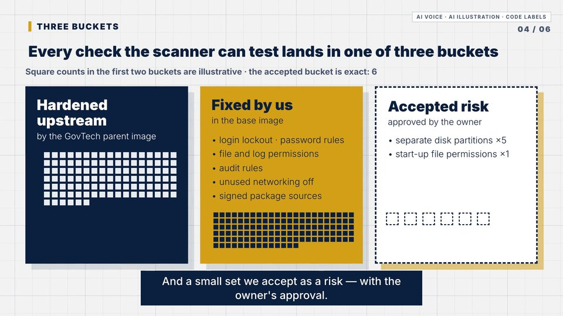

# swiss-grid (native HyperFrames 2D)

 

Based on HyperFrames' own `swiss-grid` example:
- **Colours:** grey grid paper `#f2f2f2`, navy `#0a1e3d`, gold `#d4a017` (text gold `#8a6400` for contrast).
- **Type and shadows:** Helvetica 900/300, hard offset shadows.

Reference film: [`films/aws-factory/cis-hardening`](../../films/aws-factory/cis-hardening/README.md).

**Kit:** `kit/index.template.html` is the CIS composition.
- **Reuse:** the grid drift, scene breathing, the chapter counter, the card and bucket styles, the persistent-squares pattern and the gate flow.
- **Replace:** the scenes.

**Lessons from it:**
- Animate transforms, not `left`/`top`.
- Relative bobs (`y:"-=6"`) only.
- No no-op `tl.call`; GSAP 3 has no `className` tweens.
- Keep illustrations away from the counters.
