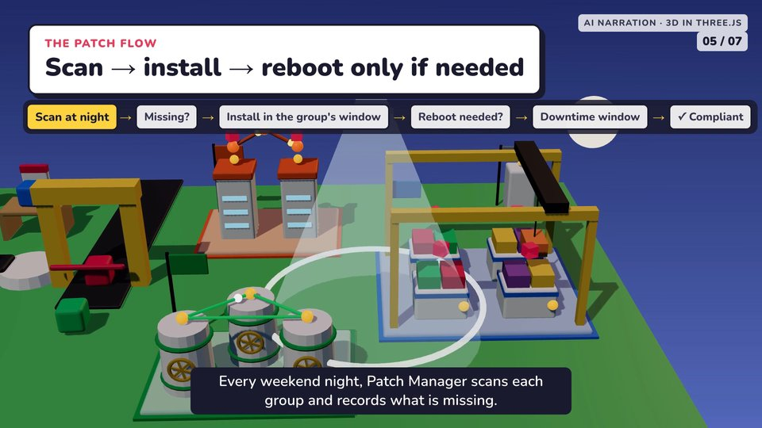
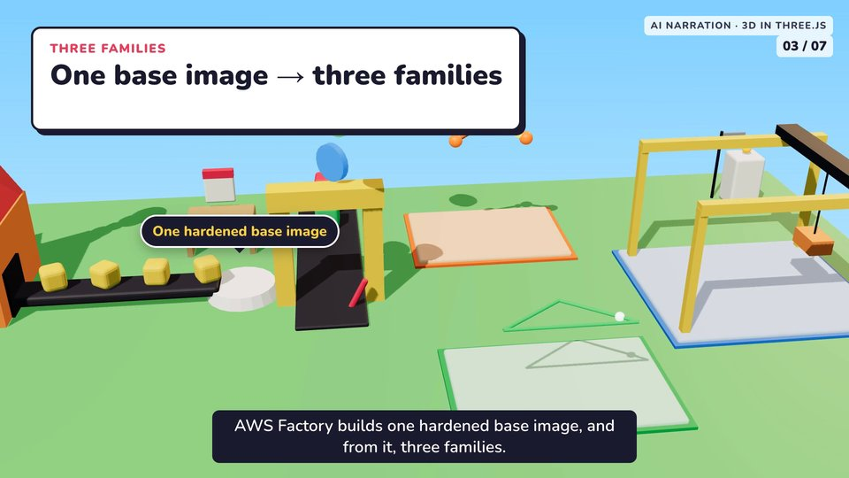

# toy-world-3d (default house look)

 

A bold toy-block 3D island built with **Three.js 0.187.0** inside HyperFrames. The owner accepted it for the SSM Patch Manager film ([`films/aws-factory/ssm-patch`](../../films/aws-factory/ssm-patch/README.md)).

## Kit (`kit/`)
| File | Reuse as is | Change per film |
|---|---|---|
| `lib/three/` | Pinned Three.js (MIT) and `RoundedBoxGeometry` | — |
| `world.js` | Helpers (`box`, `cyl`, `ball`, `rod`, `put`), lights, island, sky night blend, `camAt` dolly presets, the `apply(state, t)` pattern, scan beam, clocks, the "missing" cubes, the reboot sign | The family buildings (`FAM`, the `family()` builds), camera presets (`CAM`) and anchors for labels |
| `index.template.html` | Cards, pinned labels (clamped below the card), flow strip, report card, captions, the `hf-seek` + `buildReady` wiring, camera `KEYS` interpolation | Card text, label text, the `stateAt(t)` choreography, `KEYS` |

## Rules that make it work
- **Everything is a function of time.** Draw only inside the `hf-seek` listener. No `requestAnimationFrame`, no clock, no unseeded random.
- **Register readiness first.** `window.__hf.buildReady.world` is a promise from a classic `<script>` in `<head>`. The module resolves it after `renderer.compileAsync` and one pixel readback.
- **Each group has its own identity:** colour, building shape and an idle motion (pipeline pulses, turning wheels, a crane swapping a container). Real family names on labels.
- **The camera never stops:** a slow drift on top of preset glides. The lint's "dead stretch" warnings only see the HTML layer; check motion with `mpdecimate` on the final file.
- **Text:** Nunito (bundled by HyperFrames), with every reading text at least 28 px. Darken label colours until they reach 3:1 contrast.
- **Speed:** a 3-minute 1080p render takes about 60 s with a hardware GPU, so iterate freely.

## Palette
- Sky `#7fcfff`→`#d8f2ff`; night `#1f2a66`→`#5267b8`.
- Grass `#5cc46b`; ink `#1b1b2f`; yellow `#ffd23f`; red `#eb3b5a`.
- Family colours: GitLab `#fc6d26` (label `#c94f12`), MongoDB `#13aa52` (label `#0f8a43`), CloudOS/ECS `#2f80ed` (label `#1f6fd6`).
